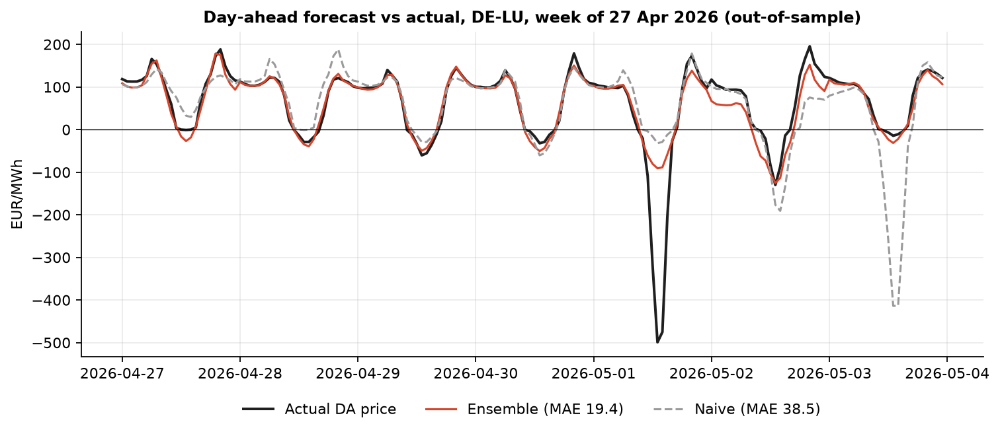
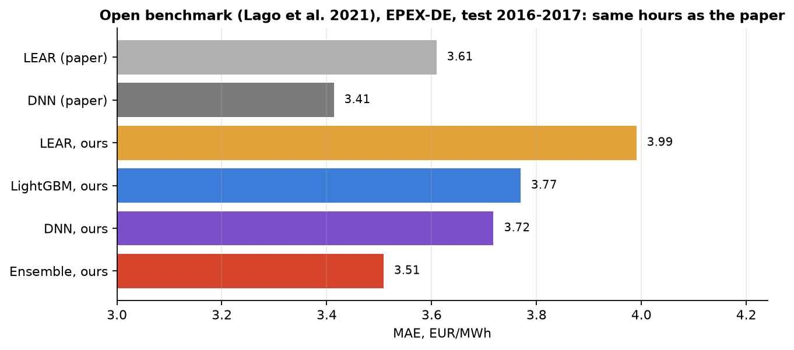
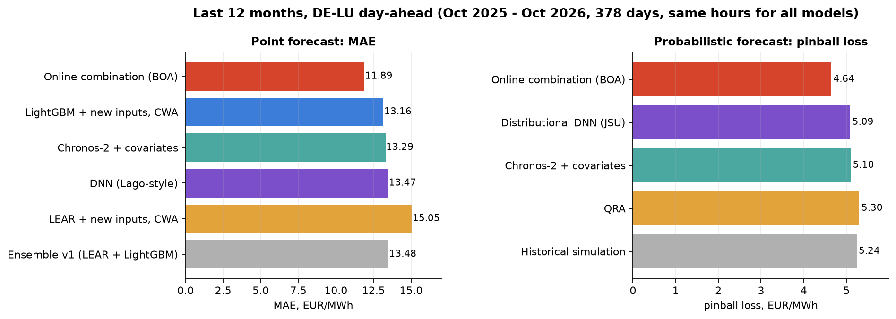
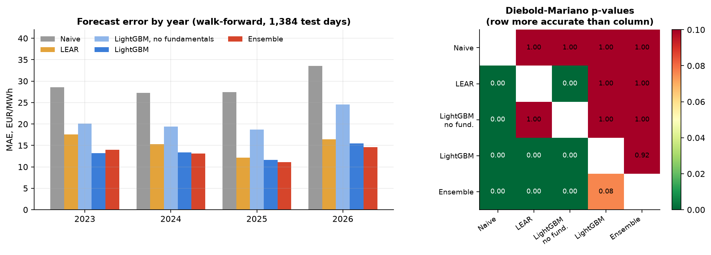
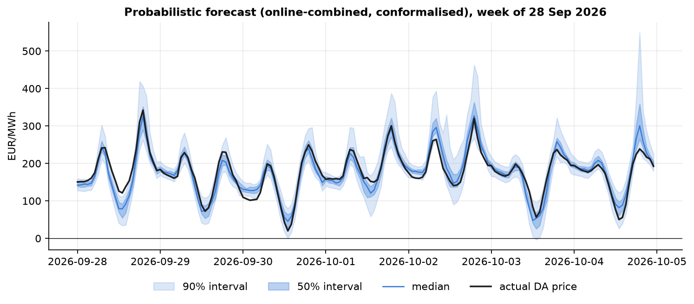
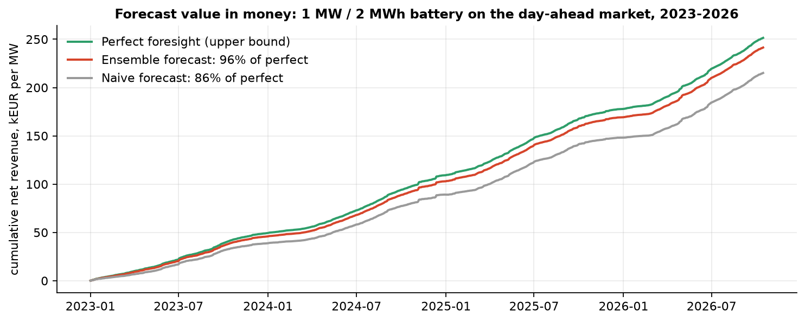
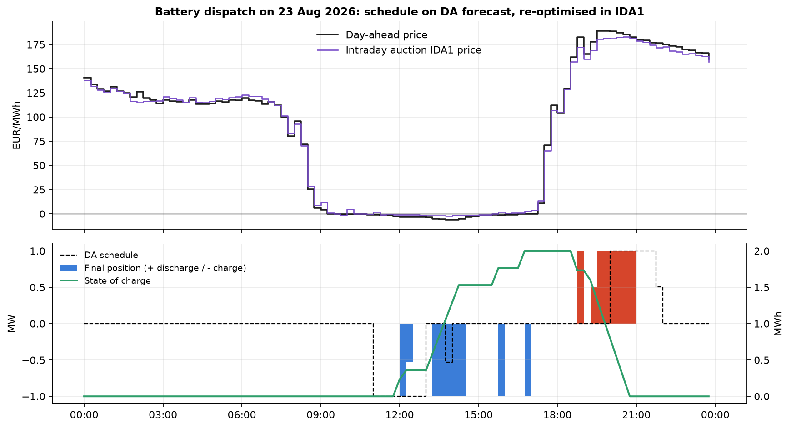
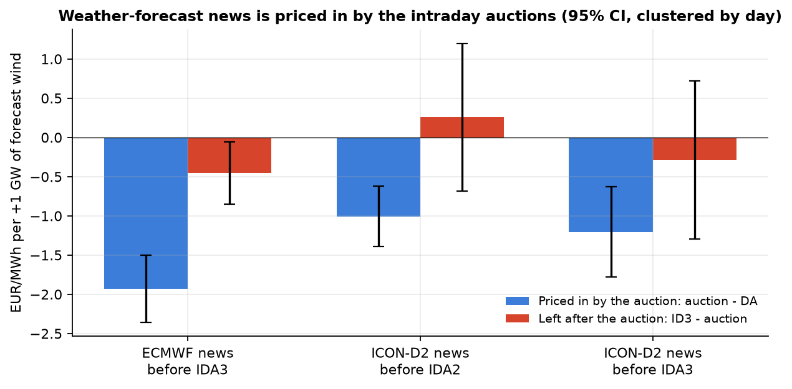
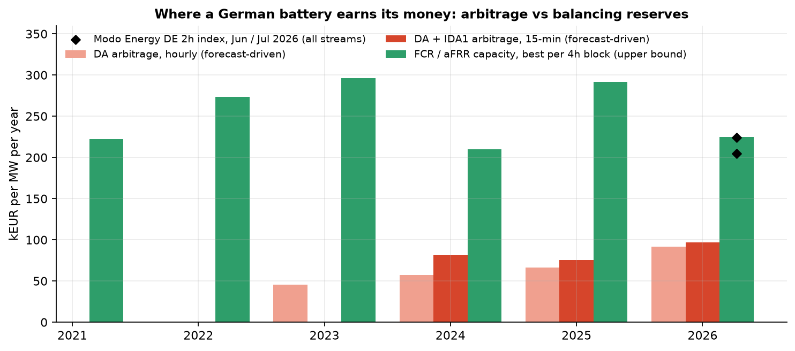
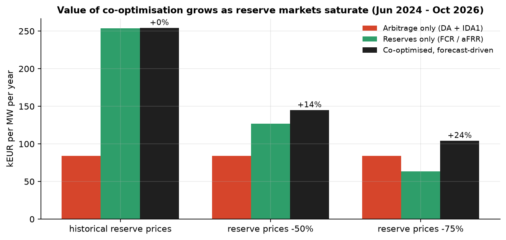

# German power markets: price forecasting, battery dispatch, and where the money is

Independent research project on the German-Luxembourg (DE-LU) bidding zone, built on public data
(ENTSO-E Transparency incl. REMIT outages, Energy-Charts / EPEX indices, regelleistung.net, Open-Meteo model runs).

**Dmytro Starostin** · traktorets300@gmail.com · Germany

---

## Results at a glance

| Question | Answer (out-of-sample) |
|---|---|
| Are the models state of the art? | On the open EPEX-DE benchmark of Lago et al. (2021) my ensemble scores **MAE 3.39 vs 3.41** for the paper's best model (DNN), on the same test hours. The difference is not significant (DM p = 0.26): **on par with the published state of the art.** |
| How accurate is the day-ahead forecast today? | Last 12 months (Oct 2025 - Oct 2026): **MAE 11.89 EUR/MWh** from an online combination of LEAR, LightGBM, a deep neural network and the Chronos-2 foundation model. That is **12% better than my first ensemble**, and significantly better than every single model (Diebold-Mariano p < 0.001). |
| Can it also say how uncertain it is? | Yes. Probabilistic forecasts: the 90% interval contains the price **90.4%** of the time. Pinball loss is **9% lower** than the best single model (p < 0.001). |
| Does better accuracy mean more money? | Yes, but not 1:1. A 1 MW / 2 MWh battery dispatched on the forecast earns **96% of the perfect-foresight revenue** (naive forecast: 86%). Re-trading in the 15-min intraday auction lifts arbitrage to **84k EUR/MW/yr**. |
| Where does a German battery earn its money? | Balancing reserves: **210-296k EUR/MW/yr** in 2021-2026 vs 73-96k from arbitrage. This matches the Modo Energy DE index (205-224k in mid-2026). |
| And when reserve prices fall? | Co-optimising reserves and arbitrage block by block earns **+14%** over the best single market if reserve prices halve, and **+24%** if they drop by 75%. |
| What did not work? | Trading public weather-forecast updates in intraday, stochastic bid curves, and choosing ensemble weights for profit instead of accuracy. Each was tested walk-forward and **reported as a negative result**. |

---

## 1. Day-ahead price forecasting

**Setup.**
- Forecast all 24 hours of day D at the auction gate closure (12:00 CET, D-1).
- Use only information available at that moment.
- Walk-forward evaluation with no look-ahead: rolling training windows, re-calibrated weekly (monthly for the neural networks).

### 1.1 Checking against the published benchmark

Before trusting my own numbers, I reproduced the open benchmark of Lago et al. (2021):
- Same EPEX-DE dataset and the same 2016-2017 test hours.
- The paper's forecasts are compared hour by hour with mine.

| Model (EPEX-DE, 2016-2017) | MAE | vs paper |
|---|---|---|
| LEAR, paper | 3.61 | |
| DNN, paper (best published) | 3.41 | |
| LEAR + LightGBM, ours | 3.55 | better than paper LEAR, p = 0.11 |
| LEAR + LightGBM + DNN, ours | **3.39** | **on par with paper DNN**, p = 0.26 |

Honest notes on this comparison:
- My LEAR alone is worse than the paper's (3.99, p < 0.001). The paper re-calibrates daily on four windows; I re-calibrate weekly to fit a single-CPU server.
- My DNN used 15 hyperparameter trials, against roughly 1,500 in the paper.

### 1.2 Models on the current market (last 12 months)

**Test period.** 1 Oct 2025 - 15 Oct 2026, 378 days.
- On 1 Oct 2025 the DA auction moved to 15-minute products, so this period is the market as it is traded today.
- Every model is scored on exactly the same hours.

**Inputs.** Added on top of the calendar, price lags and German load, wind and solar forecasts:
- **Gas (THE) and CO2 (EUA) prices**, lagged two days, because D-1 settlement is not final at 12:00.
- **8 neighbouring zones** (FR, NL, BE, AT, PL, CZ, DK1, CH): load, wind and solar forecasts for D and prices of D-1.
- **Power plant outages (REMIT) for France and Germany**, point-in-time: only messages published before D-1 11:00 count.

**Models.**

| Model | What it is |
|---|---|
| LEAR | 24 LASSO regressions on asinh-transformed prices (Lago et al. 2021). Averaged over five training windows, 56 days to 3 years (Hubicka et al. 2019). |
| LightGBM | Gradient boosting on the price relative to the D-1 mean. Averaged over 1, 2 and 3-year windows. |
| DNN | Multilayer perceptron in the style of Lago et al., with random-search hyperparameter tuning. A second, distributional version outputs a full Johnson's SU distribution per hour, trained on likelihood (Marcjasz et al. 2023). |
| Chronos-2 | Amazon's time-series foundation model. Zero-shot, with load, wind and solar forecasts as known future covariates. |
| **Online combination (BOA)** | Bernstein Online Aggregation (Wintenberger 2017). Separate weights for each hour of the day, updated daily using only outcomes up to D-1. The learning rate is itself chosen online. |

| Point forecast, last 12 months | MAE, EUR/MWh |
|---|---|
| First ensemble (LEAR + LightGBM, German inputs only) | 13.48 |
| LEAR + new inputs | 15.05 |
| DNN | 13.47 |
| Chronos-2 + covariates | 13.29 |
| LightGBM + new inputs | 13.16 |
| Simple average of four models | 12.07 |
| **Online combination (BOA)** | **11.89** |

What I take from this:
- **No single model wins**, but they fail on different days. Combining them online is the largest single gain: -12% against the first ensemble.
- BOA beats every single model (p < 0.001) and also beats the simple average (p = 0.02).
- **A foundation model with no training at all** (Chronos-2) is competitive with tuned models. Its value is as a diverse member of the combination, not as a replacement.
- **The new inputs help LightGBM, but not LEAR.** LEAR got slightly worse with more inputs and with window averaging. A linear model cannot use outage and neighbour data the way trees can.

Earlier result, kept for the longer history (first ensemble over 2023-2026, 1,384 days): MAE 13.13 vs 28.99 for the naive benchmark (-55%).

### 1.3 Probabilistic forecasts

A trader or a battery optimiser needs more than one number: they need to know how wide the risk is.

**Approach.**
- Each of five models produces 19 quantiles (5% to 95%):
  - historical simulation,
  - quantile regression averaging (QRA; Nowotarski & Weron 2015),
  - the distributional DNN,
  - Chronos-2.
- **BOA per quantile** ("CRPS learning", Berrisch & Ziel 2023). Different parts of the distribution can trust different models.
- **Conformal calibration** (CQR; Romano et al. 2019). Each interval is widened or narrowed by its own errors over the last 182 days. This gives a coverage guarantee that does not depend on the model being right.

| Model | Pinball loss | Price inside 50% interval | Price inside 90% interval |
|---|---|---|---|
| QRA | 5.30 | 43% | 82% |
| Historical simulation | 5.24 | 44% | 85% |
| Chronos-2 + covariates | 5.10 | 45% | 86% |
| Distributional DNN | 5.09 | 51% | 89% |
| **Online combination (BOA)** | **4.64** | **51%** | **90%** |
| QRA + conformal calibration | 5.27 | 47% | 87% |
| Chronos-2 + conformal calibration | 5.09 | 49% | 89% |

- **The combination is both sharper and better calibrated** than any single model.
- **Conformal calibration repairs intervals that are too narrow** (QRA: 82% → 87%, Chronos-2: 86% → 89%). The combined forecast hardly needs it.

## 2. From forecast to money: battery dispatch

Each day a linear programme (HiGHS) schedules the battery on the forecast. The schedule is then
settled at actual prices. Battery assumptions:
- 1 MW / 2 MWh
- 88% round-trip efficiency
- at most 1 cycle per day
- degradation cost 10 EUR/MWh

The upper bound is the same LP with perfect foresight.

**Two markets.** After the day-ahead auction clears, the battery is re-optimised in the
15-minute intraday auction IDA1 (15:00 D-1). It uses the known DA prices plus a learned
quarter-hour shape, and pays a fee on every re-traded MWh.

| EUR per MW per year (Jun 2024 - Oct 2026) | DA only | DA + IDA1 | Perfect foresight DA | Perfect foresight ID1 |
|---|---|---|---|---|
| 1 cycle / day | 75,600 | **84,000** | 80,500 | 104,100 |
| 2 cycles / day | 83,600 | **95,700** | 90,400 | 119,100 |

- Re-trading in IDA1 adds money on 91% of days.
- The model even beats perfect-foresight DA-only trading, because IDA1 lets the battery trade the 15-min price "sawtooth" that the hourly DA market could not.
- That benefit shrank after the DA market itself moved to 15-min products on 2025-10-01: +11.3k EUR/MW/yr before the switch, +4.7k after.

### 2.1 Does uncertainty-aware bidding pay? (negative result)

**Stochastic bid curves.** Instead of bidding a fixed schedule, the battery submits price-dependent bid curves:
- The curves are optimised over 30 price scenarios (Fleten & Pettersen 2005, monotone bidding LP).
- The scenarios are drawn from the probabilistic forecast. A Gaussian copula keeps the dependence between hours.

| Scenario source | Test days | Stochastic minus deterministic, EUR/MW/yr | t-stat |
|---|---|---|---|
| QRA | 837 | +65 | 0.90 |
| Online combination + conformal | 312 | -109 | -1.45 |

**Decision-focused ensemble weights.** Each week, the weights of LEAR, LightGBM and the DNN are chosen on the past 91 days. Two rules are compared:
- Weights chosen for battery profit: 91.6k EUR/MW/yr.
- Weights chosen for accuracy: 91.6k EUR/MW/yr.
- The difference is -46 EUR/MW/yr (t = -0.71).

**Why neither helps.** A small price-taking battery mostly needs the *ranking* of the cheap and expensive hours, and all good forecasts already get that ranking right. The intraday re-optimisation then corrects most remaining mistakes. Uncertainty-aware bidding should matter more for a larger, price-setting portfolio, or without an intraday market to fall back on.

## 3. Intraday: testing for an edge, and not finding one

**Hypothesis.** Weather forecasts are updated after the DA auction, so a trader who reacts to
new model runs should be able to trade ahead of the intraday price.

**Data.**
- ~1,000 archived ECMWF IFS runs and ~580 DWD ICON-D2 runs for 12 German locations.
- The weather is mapped to MW with a linear model calibrated on the ENTSO-E wind and solar forecasts (R² 0.92-0.95).
- "News" is the newest run usable before the auction gate minus the run available at DA time.
- Each run's publication delay is respected: about 7 h for ECMWF and about 2 h for ICON-D2.

**Result.**
- An extra GW of forecast wind lowers the intraday auction price by 1-2 EUR/MWh (t up to -8.8), so the information is real.
- After the auction, almost nothing is left to trade: the effect on ID3 minus the auction price is small or not significant.
- A walk-forward strategy (enter in IDA2/IDA3, exit at ID3/ID1) has a 44-50% hit rate and roughly zero P&L after costs.
- The faster ICON-D2 updates do not change this.

**Conclusion.** Public weather forecasts are efficiently priced. An intraday edge has to come from somewhere else:
- better proprietary forecasts,
- faster execution in the continuous market,
- a flexible physical asset.

## 4. Balancing reserves and co-optimisation

I pulled capacity auction results from regelleistung.net (every 3rd day, 2021-2026). For each
4-hour block I took the better of FCR and aFRR (positive and negative).

| EUR/MW/yr | 2021 | 2022 | 2023 | 2024 | 2025 | 2026 YTD |
|---|---|---|---|---|---|---|
| Best reserve per 4h block | 222k | 273k | 296k | 210k | 291k | 225k |
| Arbitrage DA + IDA1 (sec. 2) | - | - | - | 73k* | 76k | 96k |

\*Arbitrage for 2024 covers June-December only, annualised.

**Reading this correctly:**
- The same MW is sold either as reserve capacity or as energy in a given block, so the two figures cannot be added.
- These markets are small and saturating. German FCR demand is about 0.56 GW, against a battery pipeline of many GW, so historical reserve prices are not a forecast.
- The 2026 level lines up with the independent [Modo Energy](https://modoenergy.com/benchmarking/methodology/germany) 2-hour index: 224k (June) and 205k (July), of which aFRR capacity is about 52%.

### 4.1 Co-optimising reserves and arbitrage

**The question.** What is the best split of the same battery between reserves and trading, and how does it change if reserve prices fall?

**The model.** One linear programme per day, in 15-minute steps with six 4-hour reserve blocks.
- **Choice per block:** how many MW of FCR, aFRR+ and aFRR- to sell. The rest of the power and energy goes to DA and IDA1 arbitrage.
- **Deliverability constraints:**
  - Power: discharge + FCR + aFRR+ ≤ 1 MW, and the same for charging.
  - State of charge: it must stay inside a band, so the battery can sustain full activation (0.5 h for FCR, 1 h for aFRR).
- **Real decision timeline:**
  - Reserve auctions, morning of D-1: forecast reserve prices.
  - DA, 12:00: forecast DA prices, with reserves already fixed.
  - IDA1, 15:00: known DA prices.
- **Settlement:** at actual prices.

| kEUR/MW/yr (Jun 2024 - Oct 2026) | Arbitrage only | Reserves only | **Co-optimised** | Co-optimised, perfect foresight |
|---|---|---|---|---|
| Historical reserve prices | 83.9 | 253.9 | **254.1** | 269.8 |
| Reserve prices -50% | 83.9 | 126.9 | **144.8** (+14%) | 161.6 |
| Reserve prices -75% | 83.9 | 63.5 | **104.0** (+24%) | 119.5 |

- **At today's prices the answer is simple:** sell almost everything as aFRR capacity. Co-optimisation adds little.
- **As reserve markets saturate, the split becomes the business.** The optimiser moves capacity into arbitrage block by block and beats either single strategy.
- **The forecast-driven version captures 87-94% of the perfect-foresight value.**

## 5. Production thinking: forecast vintages

ENTSO-E serves only the *latest* version of each forecast. Wind and solar forecasts can be
updated until 18:00 on D-1, after the 12:00 gate closure. A backtest on downloaded history can
therefore be slightly optimistic. I quantify this risk instead of ignoring it, and fix it going
forward:
- A systemd timer stores what the ENTSO-E and Energy-Charts forecasts looked like 7× a day (`snapshot.py`, `deploy/`).
- This builds a true point-in-time dataset for honest backtests.

The same discipline applies to the outage data. Only messages published before the gate closure are used.

## 6. Limitations

- **Re-calibration and tuning are lighter than in research papers.** Training is weekly, not daily, and hyperparameter search is short. Everything runs on a single-CPU server.
- **Outage history has a gap.** ENTSO-E returns only the latest revision of each outage message. An outage that was later revised therefore disappears from the history. This causes no look-ahead, but it makes the feature weaker than it would be live.
- **Reserve and co-optimisation revenues are upper bounds:**
  - aFRR activation energy is not modelled.
  - Every bid is assumed accepted at the average accepted price.
  - Prequalification limits are not modelled.
- **Battery results assume a price-taker.** One MW does not move the market.

---

## Repository contents

This public repository contains the data pipeline, evaluation code, figures and aggregated
results. **The forecasting models, the forecast combination, the battery optimisation and the strategy code are kept private
and can be shown on request or in an interview.**

| File | Purpose |
|---|---|
| `download.py` | ENTSO-E Transparency downloader: prices, load, wind/solar and generation forecasts, 2019 → today. Resumable. |
| `download_neighbours.py` | Neighbouring zones (8) and REMIT generation outages with publication times, for point-in-time features |
| `download_ec.py` | Energy-Charts downloader: intraday ID1/ID3, gas (THE), CO2 |
| `features.py` | Leakage-safe hourly feature table (information set at gate closure) |
| `evaluate.py` | MAE / RMSE / sMAPE / rMAE per year, multivariate Diebold-Mariano test |
| `snapshot.py`, `deploy/` | Point-in-time forecast archive (systemd service + timer) |
| `results/` | Aggregated results behind every number above |
| `figures/` | All charts |

Raw data is not included. ENTSO-E data needs a free API token; Energy-Charts/EPEX data is for private use only.

**Stack:** Python, pandas, scikit-learn, LightGBM, PyTorch, Chronos-2 (Hugging Face), SciPy/HiGHS (LP), matplotlib, systemd, Linux server.

## Next steps

1. **Hourly price forward curve (HPFC)** and VaR on a hedged supply portfolio.
2. **aFRR activation energy** and bid acceptance risk in the co-optimisation.
3. **Rerun the DA backtest on true forecast vintages** from the snapshot archive.
4. **Continuous intraday (XBID):** execution-driven strategies for the battery.

## References

- Lago, J., Marcjasz, G., De Schutter, B., Weron, R. (2021). Forecasting day-ahead electricity prices: A review of state-of-the-art algorithms, best practices and an open-access benchmark. *Applied Energy*, 293.
- Marcjasz, G., Narajewski, M., Weron, R., Ziel, F. (2023). Distributional neural networks for electricity price forecasting. *Energy Economics*, 125.
- Hubicka, K., Marcjasz, G., Weron, R. (2019). A note on averaging day-ahead electricity price forecasts across calibration windows. *IEEE Transactions on Sustainable Energy*, 10(1).
- Uniejewski, B., Weron, R., Ziel, F. (2018). Variance stabilizing transformations for electricity spot price forecasting. *IEEE Transactions on Power Systems*, 33(2).
- Nowotarski, J., Weron, R. (2015). Computing electricity spot price prediction intervals using quantile regression and forecast averaging. *Computational Statistics*, 30(3).
- Wintenberger, O. (2017). Optimal learning with Bernstein Online Aggregation. *Machine Learning*, 106(1).
- Berrisch, J., Ziel, F. (2023). CRPS learning. *Journal of Econometrics*, 237(2).
- Romano, Y., Patterson, E., Candès, E. (2019). Conformalized quantile regression. *NeurIPS*.
- Fleten, S.-E., Pettersen, E. (2005). Constructing bidding curves for a price-taking retailer in the Norwegian electricity market. *IEEE Transactions on Power Systems*, 20(2).
- Ansari, A. F. et al. (2025). Chronos-2: From univariate to universal forecasting. Amazon technical report.
- Diebold, F. X., Mariano, R. S. (1995). Comparing predictive accuracy. *Journal of Business & Economic Statistics*, 13(3).

---

© 2026 Dmytro Starostin. All rights reserved. The code is published for portfolio review only. No licence to use,
copy or modify it is granted without written permission.
